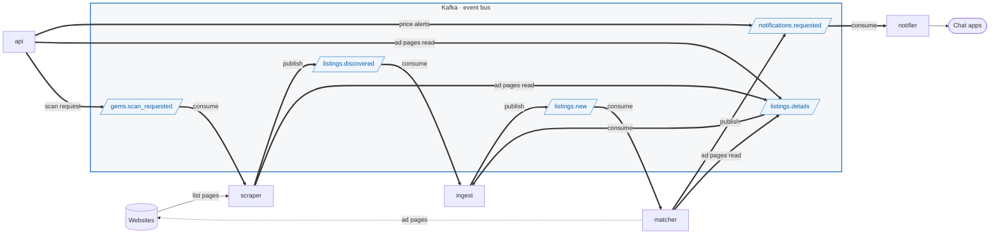
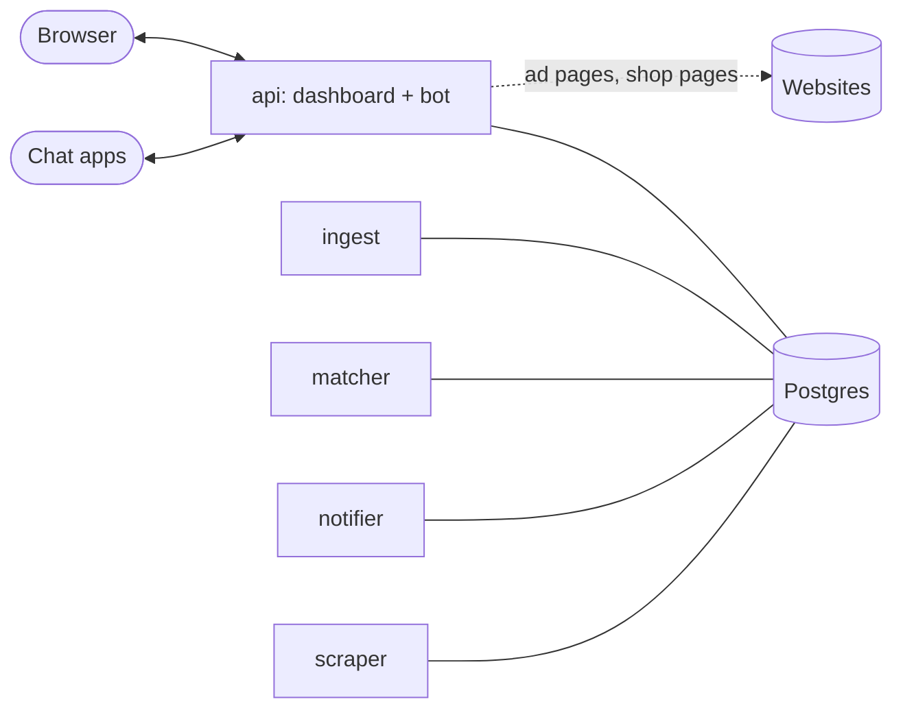
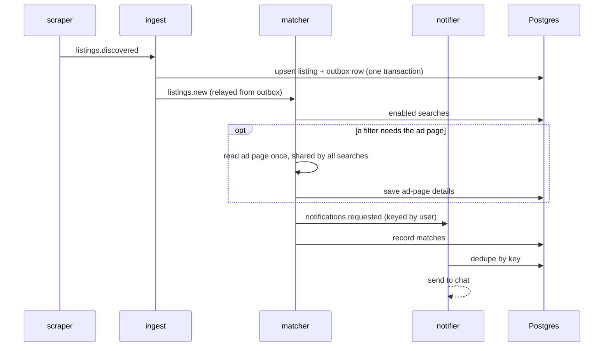
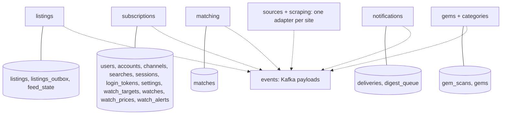
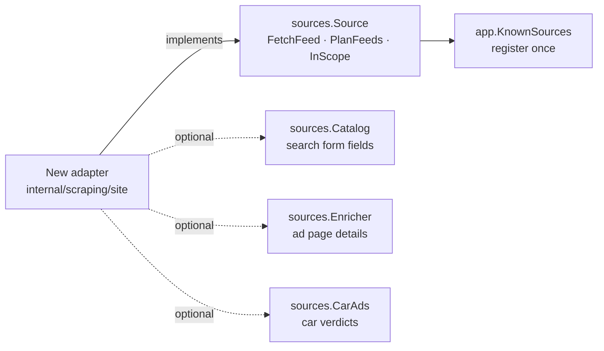
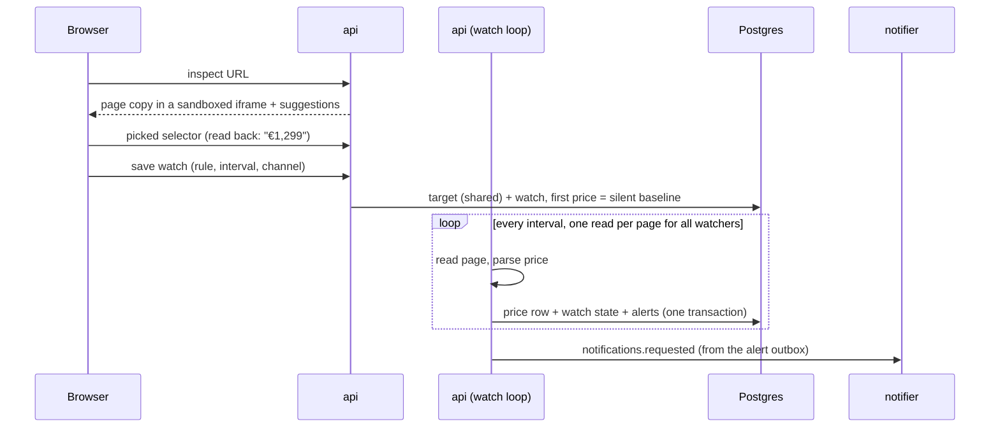

# Architecture

One Go module, five services (`cmd/*`), Kafka between them, one Postgres.
Each `internal/` slice owns its tables; slices share only `internal/events`.
Each table has **one writing service**, which alone migrates it; the others
read it and send what to write as events.
Websites plug in as **source adapters** (`internal/sources` interface, one
package per site under `internal/scraping/`). Nothing else changes per site.

## Services

Around the bus: everything that talks to people, and the shared database.

| Service | Job | Writes |
|---|---|---|
| scraper | Polls the feeds searches need, through each site's adapter; publishes every ad seen; runs gem scans | gems |
| ingest | Stores ads and what ad pages showed; outboxes the new ones (reposts marked) | listings |
| matcher | Matches new ads to searches; reads ad pages when needed; rates car alerts | matching |
| notifier | Delivers alerts, idempotent, with burst digests | notifications |
| api | Dashboard and JSON API, chat bot (`/watch`, `/searches`, `/dashboard`), price watches | subscriptions |

A reader waits at start until the owner has migrated the schema it was built
for (`AwaitSchema`). `admin` (migrate, purge) acts for every owner.

## A new ad, end to end

## Slices and their tables

One Postgres database, one schema (`public`). Each slice owns its tables and
migrates them itself (`<slice>_migrations`); no slice queries another's tables,
except the admin overview, a read-only report across all of them. No foreign
keys cross slices.

## Adding a website

Two adapters exist: `scraping/ss` (HTML feed pages, ad pages as `Enricher`, cars as `CarAds`) and `scraping/rrr`
(rrr.lt's GraphQL API, one query per search). The dashboard's editor shows a tab per registered `Catalog` (`GET /api/sources`).

## Price watches

## Guarantees

- **No lost ads:** a listing and its outbox row commit together; Kafka keeps offsets per service.
- **Outages delay, never dead-letter:** a record failing because Postgres or Kafka is down is retried until they are back.
- **No duplicate alerts:** the notifier dedupes by `search:source:ad`.
- **Polite scraping:** searches share feeds, requests are spaced, failures back off.
- **Details are kept:** ad-page facts live in `listings.details`, which scrapes don't overwrite.
